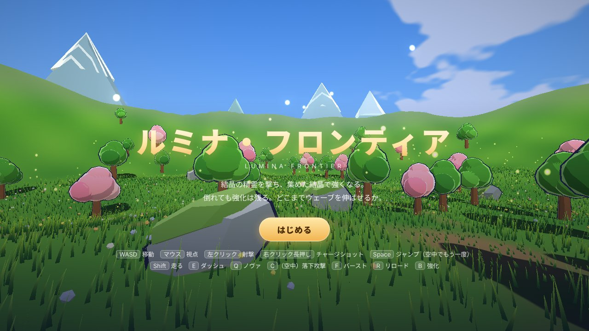
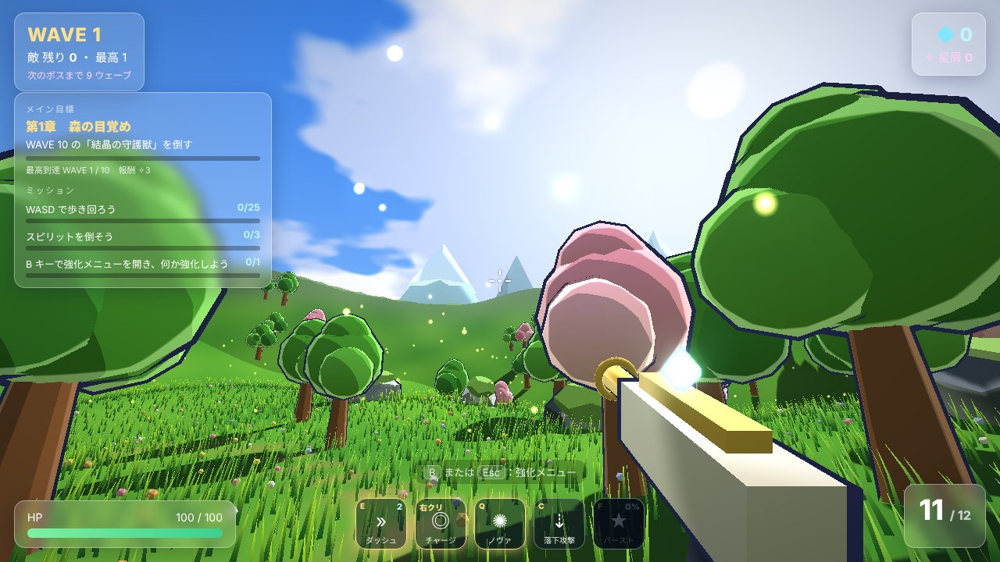

# ルミナ・フロンティア（Lumina Frontier）

ブラウザだけで遊べる、アニメ調グラフィックの**インクリメンタル FPS** です。
結晶の精霊（スピリット）を撃ち倒して結晶を集め、強化を重ねてウェーブを伸ばしていきます。倒れても強化は残ります。




## 遊び方

### オンラインで遊ぶ（GitHub Pages）

このリポジトリを GitHub Pages で公開すると、そのまま遊べます。

1. リポジトリの **Settings → Pages** を開く
2. **Source** を「Deploy from a branch」、ブランチを `main`、フォルダを `/ (root)` にして保存する
3. 数分後に表示される URL（`https://<ユーザー名>.github.io/<リポジトリ名>/`）を開く

### 手元で遊ぶ

`index.html` をブラウザで直接開くだけでも動きます。
ただしブラウザによってはローカルファイルでの動作が制限されるため、簡易サーバーを使うのがおすすめです。

```bash
# Python がある場合
python3 -m http.server 8000
# → http://localhost:8000 を開く

# Node.js がある場合
npx serve .
```

> three.js とフォントは CDN（jsDelivr / Google Fonts）から読み込むため、初回はインターネット接続が必要です。

## 操作

| キー | 動作 |
|---|---|
| `W` `A` `S` `D` | 移動 |
| マウス | 視点（画面クリックでマウスをロック） |
| 左クリック | 射撃（長押しで連射） |
| 右クリック長押し → 離す | チャージショット（敵を貫通） |
| `Space` | ジャンプ（空中でもう一度押すと二段ジャンプ） |
| `Shift` | 走る |
| `E` | ダッシュ（2回分ストック・一瞬無敵） |
| `Q` | ノヴァ（周囲の敵を吹き飛ばす） |
| `C`（空中で） | 落下攻撃 |
| `F` | オーバードライブ（ゲージ満タン時） |
| `R` | リロード |
| `B` / `Esc` | 強化メニュー（一時停止） |

マウスがロックできない環境では、ドラッグか矢印キーで視点を回せます。

## ゲームの特徴

- **インクリメンタル要素**：結晶で 11 種類の強化。放置でも結晶が貯まる「採掘」。WAVE 15 以上で「転生」して永続ボーナスの星屑を獲得。
- **目標**：全 5 章のメイン目標（各章のボス撃破）と、常に 3 つ表示されるミッション。序盤のミッションは操作チュートリアルを兼ねています。
- **敵キャラクター**：表情（まばたき・視線・眉・口）、跳ねる歩き、体の揺れ、包囲・回避・逃走・挑発などの行動。
  - ルミナ（2 連突進）／疾風（ジグザグ 3 連突進・宙返り回避）／岩殻（ガード・直線突進・鎧破壊）／星詠み（瞬間移動・追尾弾・仲間にバリア）
  - 精鋭（俊敏・堅牢・分裂・爆発）
  - ボスは 3 段階（怒り → 覚醒）で、隕石の雨や衝撃波リングを使います。
- **演出**：トゥーン調の陰影と輪郭線、風になびく草、ブルーム、ヒットストップ、コンボ、画面の揺れなど。
- **セーブ**：進行状況はブラウザの localStorage に自動保存されます（別のブラウザや端末とは共有されません）。

## 動作環境

- WebGL 2 に対応した最新の Chrome / Edge / Firefox / Safari（PC 推奨）
- 重い場合は、強化メニュー内の **設定 → 画質「軽量」** を選んでください（ブルーム・影を切り、草を減らします）。

## ファイル構成

```
.
├── index.html      # 画面のレイアウトとライブラリの読み込み
├── css/
│   └── style.css   # HUD・メニューのスタイル
├── js/
│   └── game.js     # ゲーム本体（描画・敵AI・強化・ミッションなど）
└── docs/           # README 用のスクリーンショット
```

ビルド作業は不要です。ファイルを編集してブラウザを再読み込みすれば反映されます。

## 使用ライブラリ

- [three.js](https://threejs.org/) r128（MIT License）— CDN から読み込み
- [M PLUS Rounded 1c](https://fonts.google.com/specimen/M+PLUS+Rounded+1c)（SIL Open Font License）— Google Fonts から読み込み

3D モデル・効果音・テクスチャはすべてコード内で生成しており、外部アセットは使っていません。

## ライセンス

[MIT License](LICENSE)
